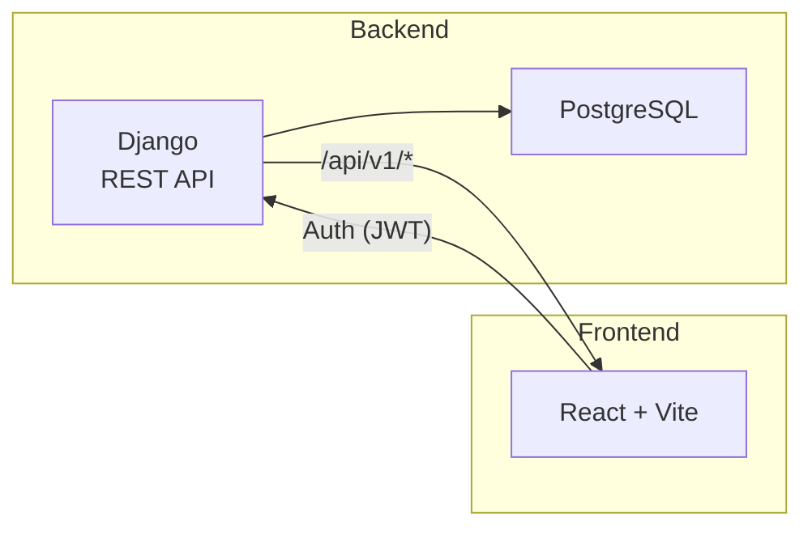

# Institute Management Platform

A Django + React institute platform for B.Tech training programs.

## Tech stack
- Backend: Django 5 + DRF + PostgreSQL
- Frontend: React 18 + Vite + TypeScript + Tailwind
- Auth: JWT + role-based access

## Project layout
- `backend/config/` contains Django base, development, and production settings and URL routing.
- `backend/apps/` contains the platform's domain apps, including accounts, batches, courses, students, trainers, leads, attendance, fees, learning, assessments, certificates, notifications, website content, colleges, reports, audit, and dashboard.
- `frontend/src/api/` contains the shared Axios client and module-specific API functions.
- `frontend/src/components/`, `layouts/`, `routes/`, `store/`, and `lib/` contain shared UI/layouts, role shells, routing/access guards, auth state, and shared helpers.
- `frontend/src/features/` is the home for module-specific screens, hooks, and types as the frontend is organized by feature.
- `.env.example` at the repository root is used by Docker Compose; `backend/.env.example` is for backend-local configuration.

## Product defaults and requirements
The platform's users, course durations, class slots, class length, learning balance, registration policy, and Phase 1/Phase 2 payment scope are documented in [PROJECT_PLAN.md](./PROJECT_PLAN.md). Change institute and schedule defaults through environment/settings; course durations can also be edited in course records.

## Account registration and email verification
- Public registration creates Student accounts only. Admin, Counsellor, and Trainer accounts remain staff-provisioned.
- New accounts cannot sign in until the one-time email code is verified. Codes expire after the configured TTL and are invalidated after the allowed number of incorrect attempts.
- In local development, `EMAIL_BACKEND=django.core.mail.backends.console.EmailBackend` prints the verification email in the backend terminal. This is for development only.
- To send real email, configure `EMAIL_BACKEND=django.core.mail.backends.smtp.EmailBackend`, `EMAIL_HOST`, `EMAIL_PORT`, `EMAIL_HOST_USER`, `EMAIL_HOST_PASSWORD`, `EMAIL_USE_TLS` or `EMAIL_USE_SSL`, and `DEFAULT_FROM_EMAIL` in the backend environment. Provider credentials belong only in the untracked local `.env`, never in the frontend or source control. TLS and SSL must not both be enabled.
- For a local checkout stored in a cloud-synced folder on Windows, keep SMTP credentials outside the checkout in `%LOCALAPPDATA%\JKIT\training-center.env`; `manage.py` loads this file automatically when it exists. You can set `DJANGO_ENV_FILE` to use a different local-only env file. Values already exported in the process environment take precedence over both files.
- Verification settings are configurable with `EMAIL_VERIFICATION_CODE_TTL_MINUTES`, `EMAIL_VERIFICATION_RESEND_COOLDOWN_SECONDS`, and `EMAIL_VERIFICATION_MAX_ATTEMPTS`.

## Quick start

### Docker Compose
```bash
cp .env.example .env
docker compose up --build
```

### Local development environment
```bash
cp backend/.env.example backend/.env
cp frontend/.env.example frontend/.env
```

Generate a private Django secret key and put it in `backend/.env` (and the root `.env` if using Docker Compose):
```bash
python -c "import secrets; print(secrets.token_urlsafe(50))"
```

Keep `.env` files private and out of source control. Example files contain placeholders only.

Then start the backend and frontend using the commands below.

### Backend
```bash
cd backend
python -m venv .venv
source .venv/bin/activate   # or .venv\Scripts\activate on Windows
pip install -r requirements.txt
python manage.py migrate
python manage.py seed_courses
python manage.py create_admin --email admin@yourdomain.com --password "Choose-A-Strong-Unique-Password"
python manage.py runserver 0.0.0.0:8000
```

For a local SQLite development database only, you can also generate demo accounts for the Admin, Trainer, and Student portals:
```bash
python manage.py create_demo_accounts
```

The command prints three randomly generated passwords once. Save them securely; they are not stored in the repository. It creates a sample assigned batch, session, and assignment so the Trainer and Student portals have demo data. It refuses to run outside `DEBUG` with SQLite and will not overwrite existing demo accounts.

### Frontend
```bash
cd frontend
npm install
npm run dev -- --host 0.0.0.0
```

### Tests
```bash
# Backend API/authentication tests
cd backend
python manage.py test

# Frontend protected-route tests
cd ../frontend
npm test
```

## Production deployment

Deploy the Django API and PostgreSQL database on Render, and deploy the Vite frontend on Vercel.

### Render backend

1. Create a PostgreSQL database in Render and note its database name, user, password, internal hostname, and port.
2. Create a Render **Web Service** from this repository with root directory `backend`, runtime Python, and branch `main`.
3. Use these commands:

   Build:
   ```bash
   pip install -r requirements.txt && python manage.py collectstatic --noinput
   ```

   Start:
   ```bash
   gunicorn config.wsgi:application --bind 0.0.0.0:$PORT
   ```

4. Configure these environment variables on the Render service:
   - `DJANGO_SETTINGS_MODULE=config.settings.prod`
   - `DJANGO_SECRET_KEY` – a newly generated private secret
   - `DJANGO_DEBUG=False`
   - `DJANGO_ALLOWED_HOSTS` – the Render service hostname, without `https://`
   - `CORS_ALLOWED_ORIGINS` – the Vercel site origin, such as `https://your-site.vercel.app`
   - `POSTGRES_DB`, `POSTGRES_USER`, `POSTGRES_PASSWORD`, `POSTGRES_HOST`, and `POSTGRES_PORT` – use the Render database values, preferably its internal hostname
5. Run `python manage.py migrate` once for the deployed database, then run `python manage.py seed_courses` to add the initial courses.

### Vercel frontend

Set the Vercel project root directory to `frontend`. Configure the environment variable `VITE_API_URL` to the Render service URL followed by `/api/v1`, for example `https://your-api.onrender.com/api/v1`. Redeploy the frontend after changing the variable.

Configure SMTP environment variables on Render if production email verification and password reset emails should be delivered. Do not put secrets in Vercel variables prefixed with `VITE_` or commit them to the repository.

## Website pages and portals

The public website includes home, about, course catalog, and contact pages, along with sign-in, student registration, and email verification. The contact page lets prospective students send an enquiry. Sign-in is shared across roles and redirects users to the appropriate portal.

| Page | Route | Access |
|---|---|---|
| Home | `/` | Public |
| About | `/about` | Public |
| Courses | `/courses` | Public |
| Contact and enquiries | `/contact` | Public |
| Sign in | `/login` | Public; shared by all roles |
| Student registration | `/register` | Public |
| Email verification | `/verify-email` | Public |
| Admin dashboard, students, batches, and leads | `/admin` | Admin, Counsellor |
| Fees and reports | `/admin/fees`, `/admin/reports` | Admin |
| Trainer dashboard and attendance | `/trainer` | Trainer |
| Student dashboard, courses, and fees | `/student` | Student |

## Service URLs
- Backend API: http://localhost:8000/api/v1/
- Frontend: http://localhost:5173/
- Swagger docs: http://localhost:8000/api/docs/

## Architecture diagram



## Environment variables

### Backend (`backend/.env.example`)
- `DJANGO_SECRET_KEY` – secret key for Django.
- `DJANGO_DEBUG` – set to `True` for local development and `False` in production.
- `DJANGO_ALLOWED_HOSTS` – comma-separated hostnames allowed to serve the backend.
- `CORS_ALLOWED_ORIGINS` – comma-separated frontend origins allowed to call the API.
- `POSTGRES_DB`, `POSTGRES_USER`, `POSTGRES_PASSWORD`, `POSTGRES_HOST`, `POSTGRES_PORT` – DB connection.
- `EMAIL_BACKEND` – e.g., `django.core.mail.backends.console.EmailBackend` (dev) or `django.core.mail.backends.smtp.EmailBackend`.
- `EMAIL_HOST`, `EMAIL_PORT`, `EMAIL_HOST_USER`, `EMAIL_HOST_PASSWORD`, `EMAIL_USE_TLS`, `EMAIL_USE_SSL` – SMTP settings.
- `EMAIL_VERIFICATION_CODE_TTL_MINUTES`, `EMAIL_VERIFICATION_RESEND_COOLDOWN_SECONDS`, `EMAIL_VERIFICATION_MAX_ATTEMPTS` – verification flow.
- `DEFAULT_FROM_EMAIL` – sender address.

### Frontend (`frontend/.env.example`)
- `VITE_API_URL` – base URL of the backend API (e.g., `http://localhost:8000/api/v1`).
- `VITE_INSTITUTE_NAME` – public institute name displayed by the frontend.

## Installing animation support

```bash
npm i framer-motion   # adds motion components for UI animations
```

## Windows‑specific notes

- Activate the Python virtual environment with:

```powershell
.venv\Scripts\Activate.ps1   # PowerShell
# or
.venv\Scripts\activate.bat   # Command Prompt
```

For local SMTP settings kept outside a cloud-synced checkout, `manage.py` loads this file automatically. If you choose a different location:

```powershell
$env:DJANGO_ENV_FILE = "$env:LOCALAPPDATA\JKIT\training-center.env"
python manage.py migrate
python manage.py runserver
```

- Path separators in Windows use backslashes (`\`). The provided commands in the README already use them where appropriate.
